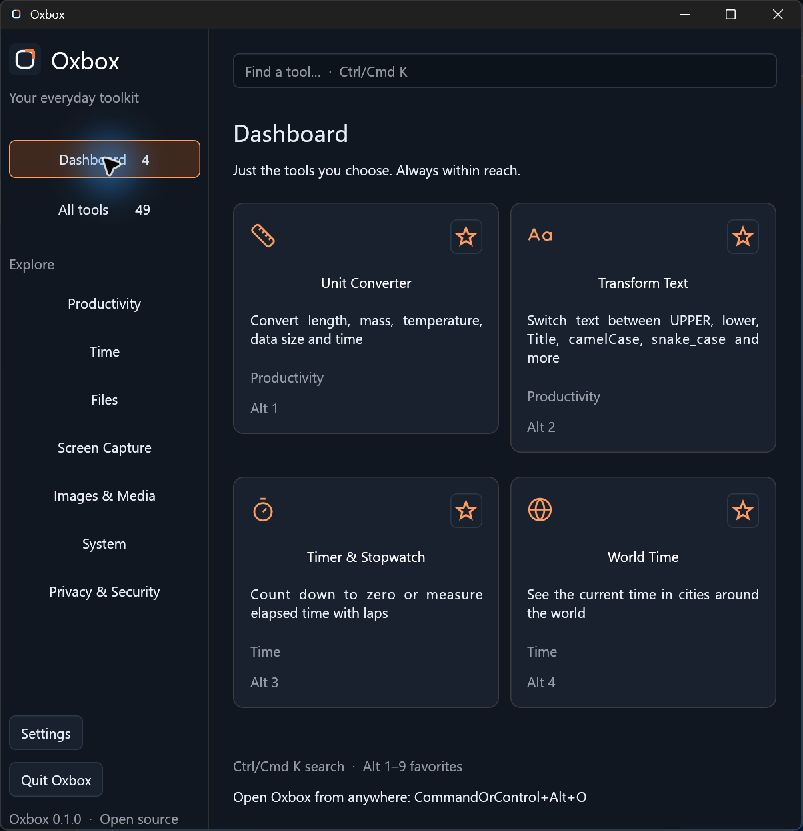
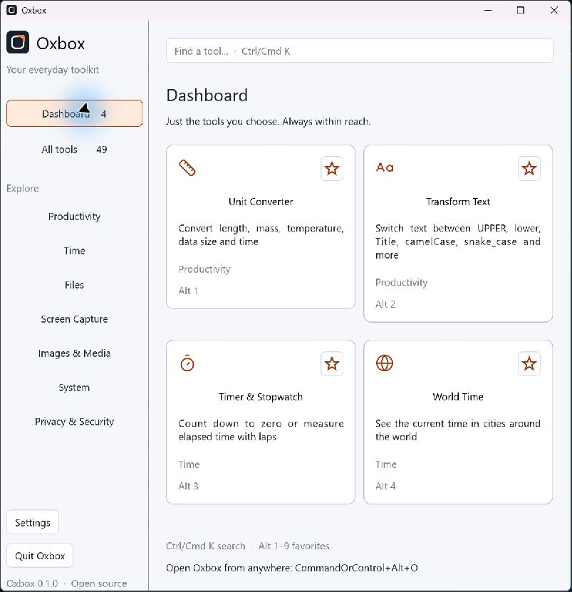

  

<h1 align="center">Oxbox</h1>

  A free, open-source toolbox of one-click desktop utilities for Windows, macOS and Linux. 
  Native Rust interface with egui. Local tools. No ads, no subscriptions, no Oxbox app telemetry.

  
  
  

---

Oxbox lives in your system tray (menu bar on macOS). Open its normal, resizable window to a dashboard containing
only your favorites. Search all **49 tools**, browse a category, or open a pinned tool with **Alt+1–9**.
The window starts at 800 × 800 logical pixels, with native window controls and an original outlined O brand.

The default global launcher shortcut is **Ctrl+Alt+O** (**Cmd+Option+O** on macOS). Inside the app,
**Ctrl/Cmd+K** searches and **Ctrl/Cmd+Q** quits. Existing saved launcher shortcuts are retained;
conflicts can be resolved in Settings. Installed Windows/macOS copies enable login startup on the first fresh launch; later logins open quietly in the tray. You can turn this off, and upgrades preserve existing choices. See the [usage guide](docs/USAGE.md) for keyboard details.

> **Status: native implementation, awaiting release acceptance.** All 49 catalogue IDs have Rust core logic and concrete
> native forms. Debug builds, headless routes and the live Windows launcher have been observed. Automated checks and manual gates are recorded in
> [VALIDATION.md](docs/VALIDATION.md). “Ready” below means the implementation is available in source;
> it does not imply a published or independently audited release. Contributions welcome.

> **Runtime privacy:** the selected eframe/egui host has no embedded browser. The retained Tauri host previously
> exhibited WebView2 background HTTPS. Bounded Windows production observations found no owned TCP/UDP endpoints
> in the recorded startup, idle, tool and tray/Quit windows; DNS, provider, other-OS and release gates remain open. See the
> [migration checklist](tasks/native-migration.md) and [scoped privacy record](docs/RUNTIME_PRIVACY.md).

## Tools

| Category | Tool | What it does | Status |
|---|---|---|---|
| Productivity | Transform Text | UPPER, lower, Title, Sentence, camelCase, PascalCase, snake_case, kebab-case, CONSTANT_CASE | **Ready** |
| | Unit Converter | Length, mass, temperature, data size, time | **Ready** |
| | Clipboard History | Recent copied text and images, paste any again | **Ready** |
| Time | Timer & Stopwatch | Countdown and stopwatch with laps | **Ready** |
| | World Time | Current time in cities you choose | **Ready** |
| | Break Time | Reminders to take regular breaks | **Ready** |
| Files | Verify Checksum | SHA-256, SHA-1, MD5 and BLAKE3; compare with a published hash | **Ready** |
| | Find Duplicates | Identical files, even with different names | **Ready** |
| | Archive & Unarchive | Create zip/tar.gz; extract zip, tar, 7z | **Ready** |
| | Clean Drive | Temp and cache files, moved to the Recycle Bin/Trash | **Ready** |
| Screen Capture | Screenshot | Full screen, window or area to file and clipboard | **Ready** |
| Images & Media | QR & Barcode | Text or link to QR code / barcode image | **Ready** |
| | Resize Images | Batch resize and format conversion | **Ready** |
| System | System Monitor | CPU, memory, disk and top processes | **Ready** |
| | Network Usage | Live upload/download speed and totals | **Ready** |
| | Do Not Sleep | Keep the computer and display awake | **Ready** |
| | Sleep Timer | Sleep or shut down after a countdown | **Ready** |
| | Mouse Activity | Windows-only, explicitly started pointer movement while idle; pauses when input resumes | **Ready** |
| Privacy & Security | Lock Screen | Lock the computer instantly | **Ready** |
| | Hide Desktop | Hide desktop icons for presentations | **Ready** |
| | Encrypt Files | Passphrase encryption with [age](https://age-encryption.org) | **Ready** |

The original 20 tools, 28 user-promoted Phase 5 entries, and Windows-only Mouse Activity make **49 tools**, including window/app controls,
presentation tools, alarms, media recording/conversion, OCR, barcode reading, color sampling, and currency.
See [the expanded tool guide](docs/ROADMAP_TOOLS.md) for platform support and local-provider requirements.
Mouse Activity always starts stopped; it does not click, type or scroll. Read its [behavior and limits](docs/MOUSE_ACTIVITY.md)
before starting a session. A bounded Windows production GUI check reported two idle pointer movements, pause
on controlled Tab input and Stop. Physical input, held keys/buttons, locked desktops, multi-monitor/DPI and
full native acceptance remain pending; the guide identifies the tested executable and exact settings.

The [project website](https://ninad-k.github.io/oxbox/) includes the complete searchable catalog, generated from the same
[canonical JSON catalogue](catalog/tools.json) as the native and legacy interfaces. See the [website contributor guide](website/README.md). Website deployment is separate from public installer publication.

The screenshots below show the actual native Windows interface with four chosen favorites. A new dashboard
starts empty until you pin tools. Current manual acceptance is tracked in the [migration matrix](tasks/native-migration.md).

## Build from source

Prerequisites: [Rust](https://rustup.rs) **1.95+**, the native C/C++ build toolchain and platform graphics/tray
libraries. Windows uses the MSVC build tools; macOS uses Xcode command-line tools; Linux needs the packages
listed in the CI workflow and contributor guide. WebView2 is not a dependency of the selected native runtime.

    git clone --branch codex/native-renderer https://github.com/ninad-k/oxbox.git
    cd oxbox
    cargo run -p oxbox-native --locked
    cargo test -p oxbox-core -p oxbox-native --locked

The native host can use a disposable profile with --profile followed by a directory. For packaging, install
Node 22.17+ and frozen pnpm dependencies, then use the graph-checking native build wrapper:

    pnpm install --frozen-lockfile
    node scripts/build-native.mjs --check
    node scripts/build-native.mjs --bundle

The wrapper builds oxbox-native and reuses the existing bundler only as an installer tool. pnpm tauri dev/build
operate the retained legacy host and are not native release commands. See [AGENTS.md](AGENTS.md) for all checks.
The current implementation branch is codex/native-renderer. Native Windows MSI/NSIS installers and checksums
are attached to an unpublished review draft. Their downloaded hashes were verified; clean-machine behavior
and the other release gates remain open. [Functional-source CI passed](https://github.com/ninad-k/oxbox/actions/runs/44941250679)
on Windows, macOS ARM and Linux with exact Rust 1.95.0.
There is no public installer download yet. Check [Releases](https://github.com/ninad-k/oxbox/releases) for status.
Unsigned builds can produce OS warnings. The [release gates](docs/RELEASE.md) remain open.

## How it is built

The current host is crates/oxbox-native: eframe/egui renders native widgets, and owned workers handle
notifications, tasks and background controllers. It calls crates/oxbox-core directly; no browser or typed IPC
is required. The same catalog/tools.json supplies native, legacy and static-site metadata. The legacy
src/ and src-tauri/ trees remain available for parity comparison.

- [SPEC.md](SPEC.md): goals, scope, boundaries
- [tasks/plan.md](tasks/plan.md): phased roadmap with acceptance criteria
- [AGENTS.md](AGENTS.md): conventions and the step-by-step recipe for adding a tool (for humans and AI agents)
- [docs/adr](docs/adr): architecture decisions
- [docs/USAGE.md](docs/USAGE.md): every tool, shortcuts, safety limits and platform notes
- [docs/ARCHITECTURE.md](docs/ARCHITECTURE.md): native host, background services and cancellable jobs
- [docs/TESTING.md](docs/TESTING.md): automated commands and manual acceptance matrix
- [docs/RELEASE.md](docs/RELEASE.md): installer and publication checklist
- [docs/DEPENDENCIES.md](docs/DEPENDENCIES.md): dependency review and primary references
- [docs/ROADMAP_TOOLS.md](docs/ROADMAP_TOOLS.md): Phase 5 tools, providers and network opt-in
- [docs/MOUSE_ACTIVITY.md](docs/MOUSE_ACTIVITY.md): Windows pointer sessions, bounded GUI evidence and remaining acceptance
- [catalog/README.md](catalog/README.md): shared metadata, icon/view adapters and consistency checks
- [tasks/native-migration.md](tasks/native-migration.md): 49-tool route/automation/manual matrix
- [website/README.md](website/README.md): generated catalog, static site checks and GitHub Pages deployment
- [CHANGELOG.md](CHANGELOG.md): user-facing changes

## Contributing

Pick a planned tool from [tasks/todo.md](tasks/todo.md), follow the recipe in [AGENTS.md](AGENTS.md),
and open a pull request. See [CONTRIBUTING.md](CONTRIBUTING.md).

## Privacy

Oxbox implements no app telemetry. Tool commands work locally; currency rates are the sole intentional network feature:
after a separate explicit opt-in, a manual refresh downloads public ECB reference data. Amounts and selected
currencies stay local. The reviewed exception is [issue #1](https://github.com/ninad-k/oxbox/issues/1).
The selected native renderer removes the embedded WebView2 dependency. The earlier browser investigation is
preserved in [runtime privacy findings](docs/RUNTIME_PRIVACY.md), alongside bounded native Windows production
observations with no owned TCP/UDP endpoints seen. The record specifies executable hashes, separate intervals,
sample gaps and exclusions. DNS/OS-broker attribution, other tool/providers and other operating systems require
their own evidence; finite observations are not a universal zero-network guarantee.
Clipboard recording starts paused, stays in memory, and is cleared on Quit. Saved settings and tool outputs
stay on your computer. File cleanup goes to the Recycle Bin/Trash after confirmation; outputs preserve originals.
See the [usage guide](docs/USAGE.md) for limits and the [security policy](SECURITY.md) for private reports.

## License

Dual-licensed under either of [MIT](LICENSE-MIT) or [Apache-2.0](LICENSE-APACHE), at your option.

## Trademarks

Oxbox is an independent open-source project inspired by all-in-one utility suites such as Parallels Toolbox.
It is not affiliated with, endorsed by or sponsored by Parallels International GmbH. "Parallels" and
"Parallels Toolbox" are trademarks of their respective owner. No proprietary code or assets are used in Oxbox.
