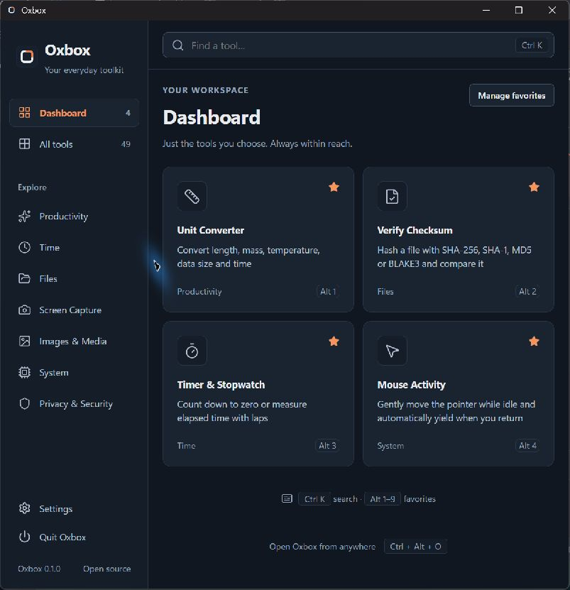
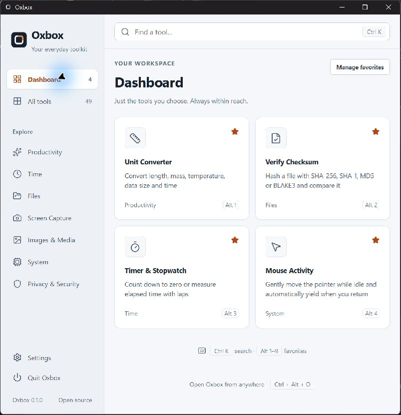

<p align="center">
  
</p>

<h1 align="center">Oxbox</h1>

<p align="center">
  A free, open-source toolbox of one-click desktop utilities for Windows, macOS and Linux.<br/>
  Built in Rust with Tauri. Local tools. No ads, no subscriptions, no Oxbox app telemetry.
</p>

<p align="center">
  <a href="https://github.com/ninad-k/oxbox/actions/workflows/ci.yml"></a>
  
  
</p>

---

Oxbox lives in your system tray (menu bar on macOS). Open its normal, resizable window to a dashboard containing
only your favorites. Search all **49 tools**, browse a category, or open a pinned tool with **Alt+1–9**.
The window starts at 800 × 800 logical pixels, with native window controls and an original outlined O brand.

The default global launcher shortcut is **Ctrl+Alt+O** (**Cmd+Option+O** on macOS). Inside the app,
**Ctrl/Cmd+K** searches and **Ctrl/Cmd+Q** quits. Existing saved launcher shortcuts are retained;
conflicts can be resolved in Settings. See the [usage guide](docs/USAGE.md) for keyboard details.

> **Status: implementation, awaiting release acceptance.** The 20-tool v0.1 catalogue and promoted Phase 5 tools have core logic, command adapters,
> typed APIs and launcher views. Automated checks and manual release gates are recorded in
> [VALIDATION.md](docs/VALIDATION.md). “Ready” below means the implementation is available in source;
> it does not imply a published or independently audited release. Contributions welcome.

> **Windows runtime privacy:** release QA observed background HTTPS from the embedded WebView2 runtime.
> Strict zero-network acceptance remains open; see the [runtime privacy findings](docs/RUNTIME_PRIVACY.md).

## Tools

| Category | Tool | What it does | Status |
|---|---|---|---|
| Productivity | Transform Text | UPPER, lower, Title, Sentence, camelCase, PascalCase, snake_case, kebab-case, CONSTANT_CASE | **Ready** |
| | Unit Converter | Length, mass, temperature, data size, time | **Ready** |
| | Clipboard History | Recent copied text and images, paste any again | **Ready** |
| Time | Timer & Stopwatch | Countdown and stopwatch with laps | **Ready** |
| | World Time | Current time in cities you choose | **Ready** |
| | Break Time | Reminders to take regular breaks | **Ready** |
| Files | Verify Checksum | SHA-256, SHA-1, MD5 and BLAKE3; compare with a published hash | **Ready** |
| | Find Duplicates | Identical files, even with different names | **Ready** |
| | Archive & Unarchive | Create zip/tar.gz; extract zip, tar, 7z | **Ready** |
| | Clean Drive | Temp and cache files, moved to the Recycle Bin/Trash | **Ready** |
| Screen Capture | Screenshot | Full screen, window or area to file and clipboard | **Ready** |
| Images & Media | QR & Barcode | Text or link to QR code / barcode image | **Ready** |
| | Resize Images | Batch resize and format conversion | **Ready** |
| System | System Monitor | CPU, memory, disk and top processes | **Ready** |
| | Network Usage | Live upload/download speed and totals | **Ready** |
| | Do Not Sleep | Keep the computer and display awake | **Ready** |
| | Sleep Timer | Sleep or shut down after a countdown | **Ready** |
| | Mouse Activity | Windows-only, explicitly started pointer movement while idle; pauses when input resumes | **Ready** |
| Privacy & Security | Lock Screen | Lock the computer instantly | **Ready** |
| | Hide Desktop | Hide desktop icons for presentations | **Ready** |
| | Encrypt Files | Passphrase encryption with [age](https://age-encryption.org) | **Ready** |

The original 20 tools, 28 user-promoted Phase 5 entries, and Windows-only Mouse Activity make **49 tools**, including window/app controls,
presentation tools, alarms, media recording/conversion, OCR, barcode reading, color sampling, and currency.
See [the expanded tool guide](docs/ROADMAP_TOOLS.md) for platform support and local-provider requirements.
Mouse Activity always starts stopped; it does not click, type or scroll. Read its [behavior and limits](docs/MOUSE_ACTIVITY.md)
before starting a session. Its native Windows acceptance remains pending.

The [project website](https://ninad-k.github.io/oxbox/) includes the complete searchable catalog, generated from the same
registry as the app. See the [website contributor guide](website/README.md). Website deployment is separate from public installer publication.

These native Windows screenshots show the revised dashboard with four favorites selected for the capture.
A new dashboard starts empty until you star tools. See the [validation record](docs/VALIDATION.md) for the checks performed.

<p align="center"></p>
<p align="center"></p>

## Build from source

Prerequisites: [Rust](https://rustup.rs) 1.93+, [Node.js](https://nodejs.org) 22.17+, [pnpm](https://pnpm.io),
and the [Tauri system dependencies](https://v2.tauri.app/start/prerequisites/) for your OS.

```bash
git clone --branch codex/complete-v0-1 https://github.com/ninad-k/oxbox.git
cd oxbox
pnpm install --frozen-lockfile
pnpm tauri dev      # run with hot reload
pnpm tauri build    # build installers into target/release/bundle
```

The current implementation branch is `codex/complete-v0-1`. Windows installers remain in a private draft;
there is no public download yet. Check the [Releases](https://github.com/ninad-k/oxbox/releases) page for status.
Draft builds are unsigned; Windows SmartScreen and macOS Gatekeeper can warn. Clean-machine installer acceptance
and the other [release gates](docs/RELEASE.md) are still open.

## How it is built

```
┌──────────────────────── Oxbox app (Tauri 2) ────────────────────────┐
│  Svelte 5 UI (src/)            Rust shell (src-tauri/)              │
│  launcher, search, tool views  tray, windows, #[tauri::command]s    │
│            │   typed IPC (src/lib/api.ts)   ▲                       │
│            └────────────────────────────────┘                       │
│                               │                                     │
│                 oxbox-core (crates/oxbox-core/)                     │
│      all tool logic, pure Rust, unit-tested, no UI dependencies     │
└─────────────────────────────────────────────────────────────────────┘
```

- [SPEC.md](SPEC.md): goals, scope, boundaries
- [tasks/plan.md](tasks/plan.md): phased roadmap with acceptance criteria
- [AGENTS.md](AGENTS.md): conventions and the step-by-step recipe for adding a tool (for humans and AI agents)
- [docs/adr](docs/adr): architecture decisions
- [docs/USAGE.md](docs/USAGE.md): every tool, shortcuts, safety limits and platform notes
- [docs/ARCHITECTURE.md](docs/ARCHITECTURE.md): IPC groups, background services and cancellable jobs
- [docs/TESTING.md](docs/TESTING.md): automated commands and manual acceptance matrix
- [docs/RELEASE.md](docs/RELEASE.md): installer and publication checklist
- [docs/DEPENDENCIES.md](docs/DEPENDENCIES.md): dependency review and primary references
- [docs/ROADMAP_TOOLS.md](docs/ROADMAP_TOOLS.md): Phase 5 tools, providers and network opt-in
- [docs/MOUSE_ACTIVITY.md](docs/MOUSE_ACTIVITY.md): Windows idle-aware pointer sessions and pending native acceptance
- [website/README.md](website/README.md): generated catalog, static site checks and GitHub Pages deployment
- [CHANGELOG.md](CHANGELOG.md): user-facing changes

## Contributing

Pick a planned tool from [tasks/todo.md](tasks/todo.md), follow the recipe in [AGENTS.md](AGENTS.md),
and open a pull request. See [CONTRIBUTING.md](CONTRIBUTING.md).

## Privacy

Oxbox implements no app telemetry. Tool commands work locally; currency rates are the sole intentional network feature:
after a separate explicit opt-in, a manual refresh downloads public ECB reference data. Amounts and selected
currencies stay local. The reviewed exception is [issue #1](https://github.com/ninad-k/oxbox/issues/1).
The embedded Windows WebView2 runtime can contact Microsoft independently. Investigation and supported controls
are tracked in the [runtime privacy findings](docs/RUNTIME_PRIVACY.md); strict whole-process offline acceptance remains open.
Clipboard recording starts paused, stays in memory, and is cleared on Quit. Saved settings and tool outputs
stay on your computer. File cleanup goes to the Recycle Bin/Trash after confirmation; outputs preserve originals.
See the [usage guide](docs/USAGE.md) for limits and the [security policy](SECURITY.md) for private reports.

## License

Dual-licensed under either of [MIT](LICENSE-MIT) or [Apache-2.0](LICENSE-APACHE), at your option.

## Trademarks

Oxbox is an independent open-source project inspired by all-in-one utility suites such as Parallels Toolbox.
It is not affiliated with, endorsed by or sponsored by Parallels International GmbH. "Parallels" and
"Parallels Toolbox" are trademarks of their respective owner. No proprietary code or assets are used in Oxbox.
