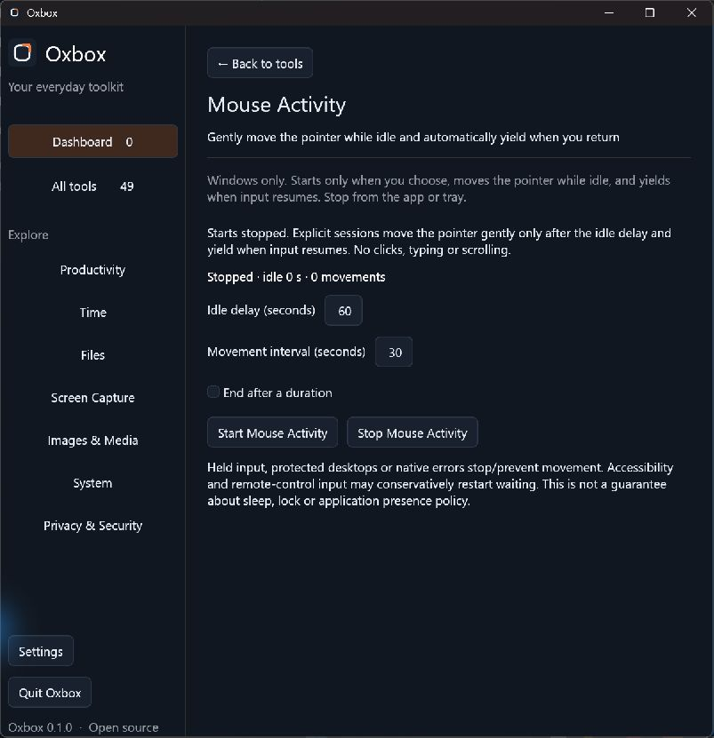

# Mouse Activity

Mouse Activity is an optional Windows tool for gentle pointer activity during an explicitly requested session.
Open the tool, choose an idle delay and movement interval, optionally set a duration, then select **Start**.
It starts stopped each time Oxbox launches. It has no schedule, login activation or saved running state.

The screenshot shows the native controls stopped with example settings. The bounded GUI check below used
a 30-second idle threshold and 30-second movement interval.

The tool waits for the full idle delay after Start or real keyboard/mouse input. While idle, it sends a small
pointer-only movement at the selected interval. It alternates direction to avoid drifting across the screen.
Real input suspends subsequent movements and restarts the idle delay. Its own synthetic events do not count
as real input. It never clicks, types or scrolls. It does not request administrator rights or bypass protected
desktops. Held input or unavailable desktop/input access prevents movement.

**Waiting for idle** means the session is enabled but is not moving the pointer. **Paused by input** means
new input restarted the idle delay. **Simulating while idle**
means the idle threshold was met. Stop is available in the tool, the launcher banner and the tray menu.
The optional duration uses a monotonic clock and expires even if the launcher is hidden. Stop, expiry,
native errors and Quit end the session and release its input observers. macOS and Linux are explicitly
unsupported in this MVP.

Stop invalidates earlier Start requests even if their background work has not begun. Session cleanup waits
for the worker to finish. The tray signals Stop at the native click callback before asynchronous recovery
is scheduled. Native launcher actions retain their admission order before background execution; recovery
can invalidate an older pending Start while a dialog blocks UI updates. The core validates action-bound
requests rather than accepting stale, unknown, replayed or malformed tokens.

Mouse Activity observes only event timing in memory. It does not retain key contents, text, input history
or pointer trails and makes no network requests. Input detection and injection remain subject to Windows
desktop/session permissions; an error stops the session rather than escalating privileges. This tool does
not guarantee a particular sleep, lock-screen or application presence policy.

Windows low-level hooks provide the immediate input signal. A separate session-input timer conservatively
restarts waiting on uncertain external activity if a hook is delayed or removed. The tool excludes its own
tagged synthetic movement from idle timing; accessibility/remote-control activity may conservatively pause
the session. Input can race with a movement already submitted to Windows; no stale pointer position is
restored afterward.

Native API references: [low-level input hook requirements](https://learn.microsoft.com/en-us/windows/win32/winmsg/lowlevelmouseproc),
[absolute virtual-desktop coordinates](https://learn.microsoft.com/en-us/windows/win32/api/winuser/ns-winuser-mouseinput),
and [SendInput permissions and return value](https://learn.microsoft.com/en-us/windows/win32/api/winuser/nf-winuser-sendinput).

## Contributor checks

The module's automated tests use fake input and clock backends. They must never move the test runner's
pointer. Before claiming Windows native acceptance, coordinate a disposable session with the tester and
record the OS, idle/interval settings and results: full idle delay, real keyboard/mouse interruption,
duration expiry, held input, multi-monitor edges, banner/tray Stop, Quit and restart stopped. Check unsupported
platform labeling separately. See [the task specification](../tasks/mouse-activity.md).

On 2026-11-21, a controlled Windows GUI check used production build **A**, executable SHA-256
`6fb64ef38e8a5725c72ef614cf78fc304775d8ed8310606ac72f45a447ba91b5`. With idle delay **30 seconds** and
movement interval **30 seconds**, the view reported **Simulating** and **2 pointer movements** after
**71 seconds**. A controlled **Tab** input changed the state to **Paused**, with idle time **0 seconds**;
selecting **Stop** reported **Stopped**. This establishes that bounded MVP path on that build/session.

It does not establish physical keyboard/mouse coverage, held-button/key behavior, duration expiry, locked or
protected desktops, monitor edges/gaps, multi-monitor/DPI behavior, every recovery path, or later-build
equivalence. Those remain separate acceptance checks. Historical Tauri no-motion checks and its browser
process counts remain in [validation](VALIDATION.md); they do not describe this native executable.

The focused fake suite covers idle/interval/expiry logic, bounded motion/event flags, cleanup/errors,
queued request ordering and token validation. Recovery regressions also cover fast Stop while the managed
session lock or startup factory is blocked, plus refusal of starts after Quit. These automated tests do not
exercise the live pointer. See the [native migration matrix](../tasks/native-migration.md) for the remaining
manual gates and [runtime privacy record](RUNTIME_PRIVACY.md) for separately scoped observations.
